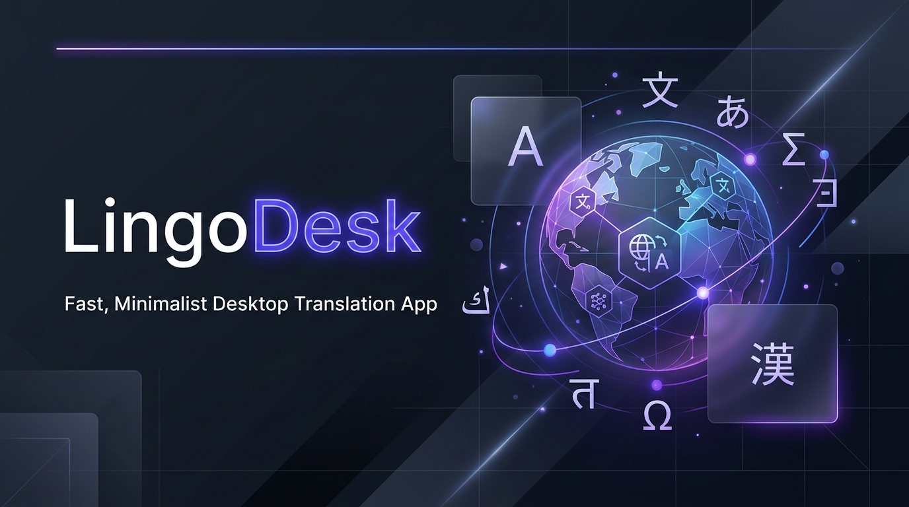
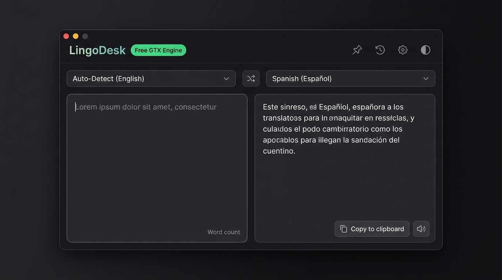
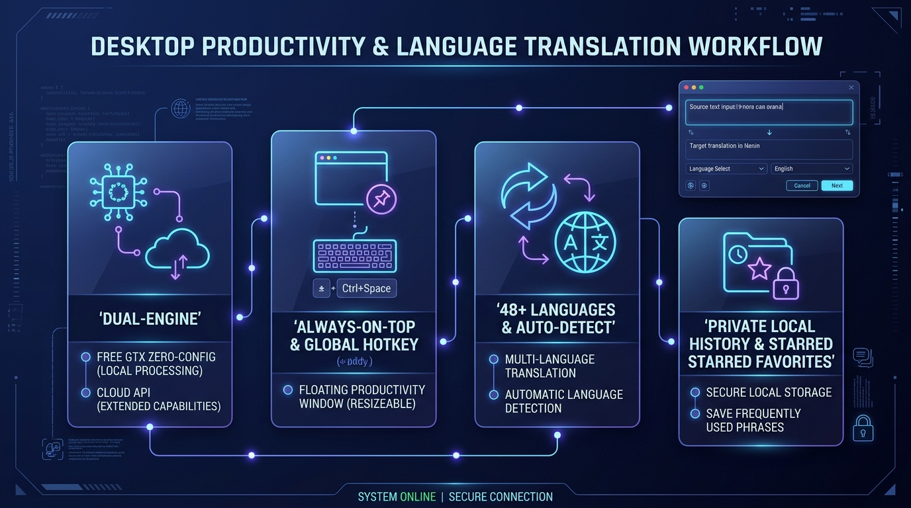

<div align="center">



# LingoDesk

**A fast, minimalist desktop translation companion powered by Google Translate.**  
*Frameless • Raycast-inspired • Dual-mode engine • Floating utility • Zero-friction*

[](https://www.electronjs.org/)
[](https://react.dev/)
[](https://www.typescriptlang.org/)
[](https://vitejs.dev/)
[](https://tailwindcss.com/)
[](LICENSE)

<br />

<p align="center">
  <a href="#-why-lingodesk">Why LingoDesk</a> •
  <a href="#-key-features">Key Features</a> •
  <a href="#-dual-engine-architecture">Dual Engine</a> •
  <a href="#-app-interface">Interface</a> •
  <a href="#-getting-started">Getting Started</a> •
  <a href="#-keyboard-shortcuts">Shortcuts</a> •
  <a href="#-architecture--security">Architecture</a>
</p>

---

</div>

<br />

<div align="center">
  
</div>

<br />

## 💡 Why LingoDesk?

### The Problem
- **Browser Tab Clutter & Context Switching:** Opening a dedicated browser tab just to translate a snippet of code, an error message, or an excerpt from a PDF breaks focus and adds memory bloat.
- **Sluggish Web Interfaces:** Modern web translator apps are laden with heavy scripts, account prompts, and navigation chrome that slow down quick translations.
- **Existing Desktop Tools Are Cumbersome:** Many desktop translation utilities force users to sign up for paid subscriptions, display intrusive ads, or demand complex cloud billing and API keys before translating a single sentence.

### The Solution
**LingoDesk** was built from the ground up to be a **featherweight, keyboard-first desktop utility** that stays entirely out of your way until you summon it:

1. **Zero Configuration, Instant Startup:** Ready out-of-the-box using the high-performance public Google Translate (GTX) engine—no credit card, API key, or account required.
2. **Summon from Anywhere:** Press <kbd>Ctrl</kbd> + <kbd>Shift</kbd> + <kbd>T</kbd> from any application (IDE, browser, document reader) to focus or unhide LingoDesk in a millisecond.
3. **Pin & Multitask:** Toggle the **Always-on-Top** pin to keep LingoDesk floating beside your editor or documentation while you work.
4. **Privacy-First & Local:** Translation history and starred phrases are stored strictly on your local machine in an atomic JSON store—no telemetry, no tracking.

---

## 🚀 Key Features

<div align="center">
  
</div>

<br />

### 🌐 Dual-Mode Translation Engine
- **Free GTX Engine (Default):** Zero-config Google Translate endpoint. Employs intelligent payload inspection—using fast `GET` requests for brief queries and switching to URL-encoded `POST` for long texts (up to 10,000 characters). Includes automatic echo-detection and fallback retry.
- **Google Cloud Translation API v2:** Built-in support for official Google Cloud API credentials. Features an in-app **API Key Tester** to validate credentials and permissions with one click.

### ⚡ Real-Time Debounced Translation
- Type naturally: input is automatically debounced (400ms) with sequence-guarding references (`sequenceRef`) so slow networks never overwrite fresher translations.
- Or hit <kbd>Ctrl</kbd> + <kbd>Enter</kbd> (<kbd>Cmd</kbd> + <kbd>Enter</kbd> on macOS) to translate immediately.

### 🔄 Bi-Directional Instant Swap
- Click the exchange button to swap both language selections **and** reverse the source and target text areas simultaneously.
- If source language is on **Auto-Detect**, swapping intelligently uses the actual detected language as the new target.

### 📌 Always-on-Top & System Tray Companion
- **Pin to Top:** Float the window over any background app without losing focus on your primary work.
- **Close to Tray:** Minimizes quietly to the system notification area rather than cluttering your taskbar.
- **Global Shortcut:** Press <kbd>Ctrl</kbd> + <kbd>Shift</kbd> + <kbd>T</kbd> (<kbd>Cmd</kbd> + <kbd>Shift</kbd> + <kbd>T</kbd>) anywhere on the system to toggle visibility.

### 🗣️ Native Text-to-Speech (TTS)
- Integrated Web Speech API audio playback for both source and translated text with automatic BCP 47 language code mapping and voice matching.

### 📚 History & Starred Favorites
- **Recent History:** Automatically saves up to 100 recent translations with relative timestamps and source/target language tags.
- **Starred Drawer:** Bookmark frequently used terms or important phrases (up to 200 items) for instant one-click restoration.
- **Full Control:** Delete individual history entries or clear history entirely with one click.

### 🌓 Adaptive Theming & Modern Aesthetics
- Dark and Light themes tailored with modern typography and sleek HSL color tokens.
- Follows system OS preference automatically until manually overridden.
- Custom window titlebar with frameless window controls (minimize, maximize, restore, close-to-tray).

### 🌍 48+ Supported Languages
Includes real-time fuzzy search across English and native names:
> *English, Spanish, French, German, Italian, Portuguese, Dutch, Russian, Ukrainian, Polish, Czech, Slovak, Swedish, Danish, Finnish, Norwegian, Icelandic, Hungarian, Romanian, Bulgarian, Greek, Turkish, Arabic, Hebrew, Persian, Urdu, Hindi, Bengali, Punjabi, Gujarati, Marathi, Tamil, Telugu, Malayalam, Kannada, Thai, Vietnamese, Indonesian, Malay, Filipino, Chinese (Simplified & Traditional), Japanese, Korean, Swahili, Afrikaans, Croatian, Serbian…*

---

## 🛠️ Dual-Engine Architecture

| Feature | Free GTX Mode (Default) | Cloud API v2 Mode |
|---|---|---|
| **Setup Required** | None (Zero configuration) | Google Cloud API Key |
| **Cost** | Free | Pay-as-you-go / Google Cloud Quota |
| **Request Protocol** | Auto-switching `GET` / `POST` | Official Google Cloud REST v2 |
| **Character Limit** | 10,000 characters per request | 10,000 characters per request |
| **Echo Protection** | Yes (Auto-retries on identical echo) | Yes (Auto-retries with auto-source) |
| **Key Validator** | Not applicable | Built-in test check in Settings |

---

## ⌨️ Keyboard Shortcuts

| Shortcut | Context | Action |
|---|---|---|
| <kbd>Ctrl</kbd> + <kbd>Shift</kbd> + <kbd>T</kbd> | Global (System-wide) | Summon / Focus / Hide LingoDesk window |
| <kbd>Ctrl</kbd> + <kbd>Enter</kbd> / <kbd>Cmd</kbd> + <kbd>Enter</kbd> | App Window | Translate input text immediately |
| <kbd>Escape</kbd> | App Window | Close Settings modal or History drawer |
| <kbd>Enter</kbd> | History Drawer | Restore highlighted translation record |

---

## 📂 Project Structure

```
google-lang-translator/
├── electron/                  # Electron Main Process & Native Bridges
│   ├── main.ts                # Window creation, tray, global shortcuts & IPC
│   ├── translate.ts           # Dual-engine translator (GTX + Cloud API v2)
│   ├── store.ts               # Debounced atomic JSON store in userData
│   └── preload.ts             # Secure contextBridge API surface
├── src/                       # React Renderer Process (Vite + TypeScript)
│   ├── components/            # UI Components
│   │   ├── HeaderBar.tsx          # Custom frameless titlebar with window controls
│   │   ├── LanguageSelectorBar.tsx# Language pair selection and swap button
│   │   ├── LanguageSelect.tsx     # Searchable language selector dropdown
│   │   ├── SourcePanel.tsx        # Source text editor with word/char counters
│   │   ├── TargetPanel.tsx        # Translation display with copy/favorite/TTS
│   │   ├── HistoryDrawer.tsx      # Slide-out history and starred drawer
│   │   └── SettingsModal.tsx      # Engine selector and API key manager
│   ├── context/               # React Context Providers (Theme & Toasts)
│   ├── hooks/                 # Custom React Hooks
│   │   ├── useDebounce.ts         # Input debounce hook
│   │   └── useTranslation.ts      # Translation lifecycle and sequence guard
│   ├── lib/                   # Utilities, language registry & speech engine
│   ├── types/                 # Application TypeScript interfaces
│   ├── App.tsx                # Main container application
│   └── index.css              # Custom styling tokens and Tailwind directives
├── docs/assets/               # High-resolution documentation graphics
└── resources/                 # Application icons (.ico and .png)
```

---

## 🔒 Security Posture

LingoDesk enforces Electron security best practices:
- **`contextIsolation: true`** — Isolates renderer code from Electron internal APIs.
- **`nodeIntegration: false`** — Prevents Node.js runtime access directly in the UI.
- **IPC Validation** — Every IPC invocation checks `isTrustedSender(event)` against the main window's webContents.
- **Window Open Prevention** — `setWindowOpenHandler` denies arbitrary popup window creation.
- **External Links** — Handled via explicit `shell.openExternal` with strict URL scheme checks (`https://`).
- **Local Storage** — Stored in `%APPDATA%/lingodesk/lingodesk-store.json` on Windows (or OS `userData` directory).

---

## 💻 Getting Started

### Prerequisites
- [Node.js](https://nodejs.org/) (v18 or v20+ recommended)
- `npm` (v9 or v10+)

### Installation

1. **Clone the repository:**
   ```bash
   git clone https://github.com/Harmain89/google-lang-translator.git
   cd google-lang-translator
   ```

2. **Install dependencies:**
   ```bash
   npm install
   ```

   > **Note:** If `node_modules/electron` is missing its binary, run:
   > ```bash
   > node node_modules/electron/install.js
   > ```

3. **Start in development mode:**
   ```bash
   npm run dev
   ```
   *Launches the Vite dev server with Hot Module Replacement (HMR) alongside Electron.*

---

## 📦 Scripts & Distribution

| Command | Description |
|---|---|
| `npm run dev` | Runs Vite dev server and launches Electron with live reload |
| `npm run build:electron` | Compiles TypeScript main and preload processes using `esbuild` |
| `npm run build:renderer` | Builds the React frontend bundle via Vite |
| `npm run typecheck` | Executes `tsc --noEmit` across main and renderer codebases |
| `npm run start` | Builds both renderer and electron, then executes the production build locally |
| `npm run pack` | Packages the application into an unpacked directory in `release/` |
| `npm run dist` | Generates a Windows NSIS Installer (`LingoDesk-Setup.exe`) and portable executable |

---

## 📄 License

This project is licensed under the [MIT License](LICENSE).
